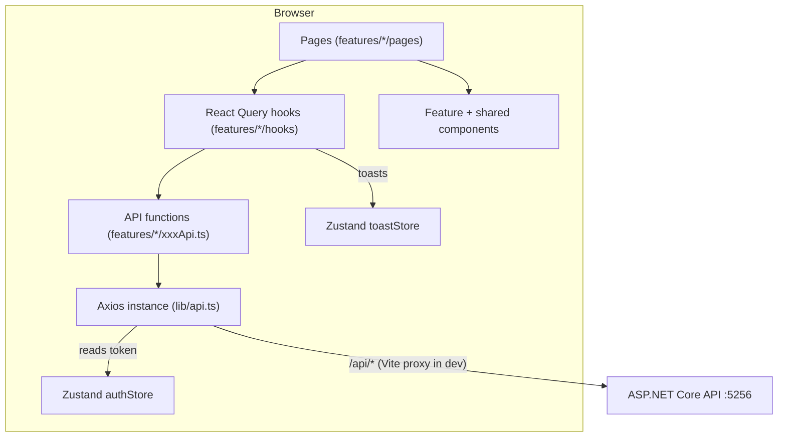
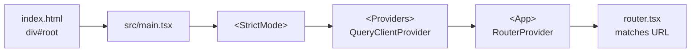
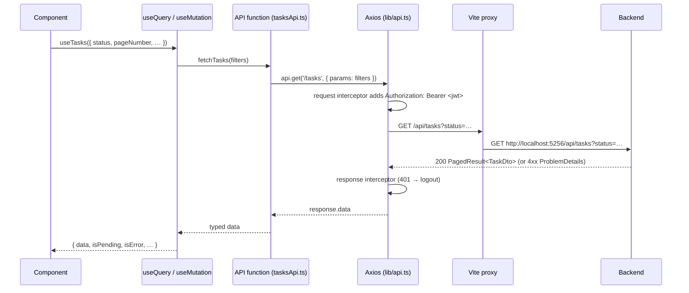
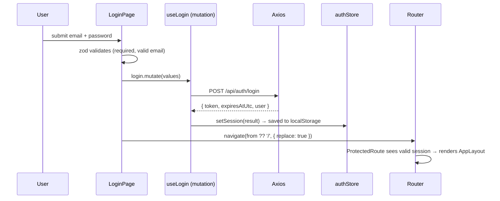

# TaskManager — Web Frontend

A React + TypeScript single-page application (SPA) for the **TaskManager** system: hierarchical task delegation (managers assign work to their direct workers), two-level deadlines (lenient → strict), reminder rules, notification history, and user administration.

This README documents the frontend **as it is currently implemented**. It is written as a learning guide: every section explains *what* the code does, *why* it is built that way, and *where* to look in the source.

> The backend (ASP.NET Core, Clean Architecture, CQRS/MediatR, PostgreSQL, JWT) lives in a separate project. Its design notes are copied into [docs/](docs/) for reference.

---

## Table of contents

1. [Tech stack](#1-tech-stack)
2. [Getting started](#2-getting-started)
3. [Architecture at a glance](#3-architecture-at-a-glance)
4. [Folder structure](#4-folder-structure)
5. [Application startup](#5-application-startup)
6. [Routing and layouts](#6-routing-and-layouts)
7. [Authentication and JWT handling](#7-authentication-and-jwt-handling)
8. [API communication (Axios)](#8-api-communication-axios)
9. [Server state with TanStack Query](#9-server-state-with-tanstack-query)
10. [Client state with Zustand](#10-client-state-with-zustand)
11. [Forms: React Hook Form + Zod](#11-forms-react-hook-form--zod)
12. [Feature walkthroughs](#12-feature-walkthroughs)
13. [End-to-end flows](#13-end-to-end-flows)
14. [Error handling, layer by layer](#14-error-handling-layer-by-layer)
15. [Shared components and utilities](#15-shared-components-and-utilities)
16. [Key React / TypeScript concepts used](#16-key-react--typescript-concepts-used)
17. [Configuration files](#17-configuration-files)
18. [Debugging tips](#18-debugging-tips)
19. [Extending the app](#19-extending-the-app)
20. [Known limitations](#20-known-limitations)

---

## 1. Tech stack

| Concern | Library | Why it's used here |
|---|---|---|
| UI | **React 19** | Component model, hooks. |
| Language | **TypeScript 6** | Catches shape mismatches between frontend and backend DTOs at compile time. |
| Build / dev server | **Vite 8** | Fast dev server with hot reload; also proxies `/api` to the backend. |
| Routing | **react-router-dom 7** (`createBrowserRouter`) | URL → page mapping, nested layouts, route guards, error pages. |
| Server state | **@tanstack/react-query 5** | Fetching, caching, pagination, polling, and cache invalidation after mutations. |
| Client state | **Zustand 5** (+ `persist`) | Tiny global stores: auth session, toasts, "last seen" notification timestamp. |
| HTTP | **Axios** | One configured instance with interceptors for the JWT and 401 handling. |
| Forms | **react-hook-form** + **zod** + `@hookform/resolvers` | Performant forms, schema-based validation, dirty-field tracking for PATCH. |
| Styling | **Tailwind CSS 4** (via `@tailwindcss/vite`) | Utility classes; dark slate theme with indigo accents. |
| Linting | ESLint 10 + `typescript-eslint`, `react-hooks`, `react-refresh` | Enforces hook rules and fast-refresh-safe module exports. |

There is **no** UI component library — every component is hand-written with Tailwind.

---

## 2. Getting started

### Prerequisites

- **Node.js** — a version supported by Vite 8 (Node 20.19+ or 22.12+).
- The **TaskManager backend** running locally on `http://localhost:5256` (see [vite.config.ts](vite.config.ts)).

### Install and run

```bash
npm install        # install dependencies
npm run dev        # start Vite dev server (default http://localhost:5173)
```

Open the printed URL and sign in with a user that exists in the backend database.

### Other scripts (from [package.json](package.json))

| Script | What it does |
|---|---|
| `npm run dev` | Starts the Vite dev server with hot module replacement and the `/api` proxy. |
| `npm run build` | `tsc -b && vite build` — type-checks the whole project first, then bundles to `dist/`. A type error **fails the build**. |
| `npm run preview` | Serves the built `dist/` folder locally to test the production bundle. |
| `npm run lint` | Runs ESLint over the project. |

### How the frontend reaches the backend

There are **no `.env` files**. The Axios instance uses a *relative* base URL, `/api`:

```ts
// src/lib/api.ts
export const api = axios.create({ baseURL: '/api', headers: { 'Content-Type': 'application/json' } })
```

During development, Vite forwards every request that starts with `/api` to the backend:

```ts
// vite.config.ts
server: {
  proxy: {
    '/api': { target: 'http://localhost:5256', changeOrigin: true },
  },
},
```

**Why a proxy?** The browser thinks it is talking to the same origin (`localhost:5173`), so no CORS configuration is needed during development. In production, whatever serves the `dist/` files must also route `/api/*` to the backend (e.g., a reverse proxy), because the built app still calls `/api/...`.

---

## 3. Architecture at a glance

The code is organised **by feature** (auth, tasks, notifications, users), with a thin shared layer (`components/`, `lib/`, `types/`) and an app shell (`app/`).



Each feature follows the same layering, from the network outwards:

| Layer | File(s) | Responsibility |
|---|---|---|
| Types | `features/x/types.ts`, `types/api.ts` | TypeScript shapes mirroring backend DTOs and enums. |
| API functions | `features/x/xxxApi.ts` | One async function per endpoint. Plain Axios calls, no React. |
| Hooks | `features/x/hooks/*.ts` | Wrap API functions in `useQuery` / `useMutation`; own query keys, cache invalidation, toasts. |
| Forms | `features/x/form/*.ts` | Zod schemas + mapping between form values and request bodies. |
| Permissions | `features/x/permissions.ts` | Pure functions deciding which buttons to show. |
| Components / Pages | `features/x/components`, `features/x/pages` | Rendering and user interaction. |

**Why this split?** Pages stay small and readable; API functions can be reused by multiple hooks; and when the backend changes a route, there is exactly one place to update.

---

## 4. Folder structure

```
taskmanager-web/
├── index.html                 # HTML shell; contains <div id="root"> and loads src/main.tsx
├── vite.config.ts             # Vite plugins (React, Tailwind), "@" alias, /api dev proxy
├── tsconfig.json              # References tsconfig.app.json + tsconfig.node.json
├── tsconfig.app.json          # Compiler options for src/ (strict-ish, "@/*" path alias)
├── tsconfig.node.json         # Compiler options for config files (vite.config.ts)
├── eslint.config.js           # Lint rules (TS, react-hooks, react-refresh)
├── package.json
├── docs/                      # Backend design notes (domain/application/infrastructure/presentation)
└── src/
    ├── main.tsx               # Entry point: mounts <Providers><App/></Providers> in StrictMode
    ├── App.tsx                # Renders <RouterProvider router={router}/>
    ├── index.css              # Single line: @import "tailwindcss";
    │
    ├── app/                   # Application shell
    │   ├── providers.tsx      # QueryClientProvider (React Query)
    │   ├── router.tsx         # All routes, guards, error boundaries
    │   ├── AppLayout.tsx      # Header (nav, bell, profile, logout) + <Outlet/> + global toasts
    │   ├── NotFoundPage.tsx   # 404 page (catch-all route)
    │   └── RouteErrorPage.tsx # Rendered by react-router when a route throws
    │
    ├── components/            # Reusable, feature-agnostic UI
    │   ├── Badge.tsx          # Coloured pill (tone: green/red/amber/slate/indigo)
    │   ├── Button.tsx         # <button> with variants and sizes
    │   ├── buttonClass.ts     # The class-name builder behind Button (also used on <Link>)
    │   ├── ConfirmDialog.tsx  # "Are you sure?" modal built on Modal
    │   ├── Field.tsx          # Label + input slot + hint/error; exports `inputClass`
    │   ├── FilterTabs.tsx     # Generic pill-style toggle group
    │   ├── Model.tsx          # `Modal` component (native <dialog>) — note the file name
    │   ├── Pagination.tsx     # Previous / "Page X of Y" / Next
    │   ├── States.tsx         # ListSkeleton, EmptyState, ErrorState
    │   └── Toaster.tsx        # Renders the toast stack from toastStore
    │
    ├── lib/                   # Non-UI infrastructure
    │   ├── api.ts             # Axios instance + request/response interceptors
    │   ├── apiError.ts        # Turn backend ProblemDetails into messages / field errors
    │   ├── dates.ts           # UTC parsing, display formatting, datetime-local conversion
    │   ├── queryClient.ts     # The single React Query client and its defaults
    │   └── toastStore.ts      # Zustand toast store + `toast.success/error/undoable/notify`
    │
    ├── types/
    │   └── api.ts             # Backend enums (TaskStatus, NotificationChannel…), PagedResult<T>, ApiProblem
    │
    └── features/
        ├── auth/
        │   ├── types.ts           # User, AuthResult
        │   ├── authStore.ts       # Persisted session (token, expiry, user) + isSessionValid()
        │   ├── hooks/useLogin.ts  # POST /auth/login → store session
        │   ├── LoginPage.tsx      # Login form
        │   ├── ProtectedRoute.tsx # Redirects to /login when not signed in; auto-logout timer
        │   └── AdminRoute.tsx     # Redirects non-admins to /
        │
        ├── tasks/
        │   ├── types.ts           # Task, TaskRelation, request body types
        │   ├── tasksApi.ts        # All /tasks endpoints
        │   ├── filterOptions.ts   # Status / relation filter tab definitions
        │   ├── permissions.ts     # canEditTask, canCompleteTask, …
        │   ├── form/
        │   │   ├── taskFormSchema.ts   # Zod schema factory + FIELD_NAMES
        │   │   └── taskFormMapping.ts  # Form ↔ DTO conversions, dirty-field update builder
        │   ├── hooks/
        │   │   ├── useTasks.ts         # taskKeys, useTasks (list), useTask (detail)
        │   │   ├── useCreateTask.ts
        │   │   ├── useUpdateTask.ts    # Up to 3 PATCH/PUT calls; partial-failure error
        │   │   └── useTaskActions.ts   # complete (optimistic), halt, resume, delete (+undo), reassign, bulk delete
        │   ├── components/
        │   │   ├── TaskCard.tsx        # One task in the list
        │   │   ├── TasksActions.tsx    # Buttons under a card (exports TaskActions)
        │   │   ├── TaskStatusBadge.tsx
        │   │   ├── ReassignDialog.tsx
        │   │   └── BulkDeleteButton.tsx
        │   └── pages/
        │       ├── TasksPage.tsx       # List with filters + pagination (URL-driven)
        │       ├── TaskDetailPage.tsx  # Read-only view + read-only reminders
        │       ├── CreateTaskPage.tsx
        │       ├── EditTaskPage.tsx    # Edit form + editable reminders
        │       └── TaskForm.tsx        # Shared create/edit form component
        │
        ├── notifications/
        │   ├── types.ts                 # NotificationRule, NotificationLog, TRIGGER_EVENT_LABELS
        │   ├── notificationsApi.ts      # Logs + rules endpoints
        │   ├── notificationSeenStore.ts # Persisted "last seen" timestamp per user (unread badge)
        │   ├── form/ruleFormSchema.ts, ruleFormMapping.ts
        │   ├── hooks/
        │   │   ├── useNotificationRules.ts  # Rules CRUD hooks
        │   │   └── useNotificationLogs.ts   # Logs list + polling bell query
        │   ├── components/
        │   │   ├── NotificationBell.tsx         # Header bell, unread badge, dropdown
        │   │   ├── NotificationToastWatcher.tsx # Pops a toast when a new log arrives
        │   │   ├── NotificationRulesSection.tsx # Reminders panel (editable or read-only)
        │   │   └── NotificationRuleForm.tsx     # Create/edit reminder modal
        │   └── pages/NotificationLogsPage.tsx   # Full log history with filters
        │
        └── users/
            ├── usersApi.ts          # All /users endpoints + the useWorkers() hook
            ├── filterOptions.ts     # Active / Inactive filter tabs
            ├── permissions.ts       # canEditUser (self or admin)
            ├── form/createUserSchema.ts, contactDetailsSchema.ts
            ├── hooks/useUsers.ts, useUserActions.ts
            ├── components/AssignManagerDialog.tsx
            └── pages/
                ├── UsersPage.tsx      # Admin user list + actions
                ├── UserDetailPage.tsx # Profile + inline contact-details edit
                ├── CreateUserPage.tsx # Admin: create user
                └── MyTeamPage.tsx     # Your direct workers
```

### The `@` import alias

Imports like `import { api } from '@/lib/api'` resolve to `src/lib/api`. The alias is declared **twice**, and both are required:

- [tsconfig.app.json](tsconfig.app.json) → `"paths": { "@/*": ["src/*"] }` — so **TypeScript** can type-check.
- [vite.config.ts](vite.config.ts) → `alias: { '@': path.resolve(__dirname, 'src') }` — so **Vite** can bundle.

---

## 5. Application startup



1. **[index.html](index.html)** has an empty `<div id="root">` and loads `/src/main.tsx` as an ES module.
2. **[src/main.tsx](src/main.tsx)** imports Tailwind (`index.css`) and renders:
   ```tsx
   createRoot(document.getElementById('root')!).render(
     <StrictMode>
       <Providers>
         <App />
       </Providers>
     </StrictMode>,
   )
   ```
   - `StrictMode` (development only) renders components and runs effects **twice** to surface bugs. This is why, for example, `Modal` checks `if (!dialog.open)` before calling `showModal()`.
3. **[src/app/providers.tsx](src/app/providers.tsx)** wraps everything in `QueryClientProvider`, so any component can call `useQuery`/`useMutation`.
4. **[src/App.tsx](src/App.tsx)** renders `<RouterProvider router={router} />`.
5. **Zustand stores need no provider.** They are module-level singletons; the persisted auth store re-hydrates itself from `localStorage` as soon as `authStore.ts` is imported.

---

## 6. Routing and layouts

All routes live in **[src/app/router.tsx](src/app/router.tsx)**:

```
/login                         LoginPage                     (public)
<ProtectedRoute>               → redirects to /login if no valid session
  <AppLayout>                  → header + <Outlet/> + Toaster + NotificationToastWatcher
    (pathless, errorElement)   → page errors render *inside* the layout
      /                        TasksPage
      /tasks/new               CreateTaskPage
      /tasks/:id               TaskDetailPage
      /tasks/:id/edit          EditTaskPage
      /users/:id               UserDetailPage
      /team                    MyTeamPage
      /notifications           NotificationLogsPage
      <AdminRoute>             → redirects non-admins to /
        /admin/users           UsersPage
        /admin/users/new       CreateUserPage
      *                        NotFoundPage
```

### Concepts

- **Layout routes and `<Outlet />`.** A route with an `element` but children renders that element and places the matched child where `<Outlet />` appears. `ProtectedRoute` returns `<Outlet />` when signed in; `AppLayout` renders the header and then `<Outlet />` inside `<main>`.
- **Pathless routes.** Routes without `path` (like `ProtectedRoute`, `AdminRoute`, and the error-boundary wrapper) don't change the URL; they only wrap their children with logic.
- **Route guards.**
  - [ProtectedRoute.tsx](src/features/auth/ProtectedRoute.tsx) — `if (!valid) return <Navigate to="/login" replace state={{ from: location.pathname }} />`. The `from` value lets the login page send the user back where they were going.
  - [AdminRoute.tsx](src/features/auth/AdminRoute.tsx) — reads `user.isSystemAdmin` from the auth store; non-admins are redirected to `/`.
  - Guards are a **UX convenience only**. The backend independently returns `403 Forbidden` for anything a user isn't allowed to do.
- **Error elements.** `errorElement: <RouteErrorPage />` is set at three levels (login, protected root, and the pathless wrapper inside the layout). React Router renders the *nearest* one when a component throws during render. The innermost one keeps the header visible. [RouteErrorPage.tsx](src/app/RouteErrorPage.tsx) shows the 404 page for route 404s, otherwise a "Something went wrong" panel with *Reload* / *Go home*.
- **Catch-all.** `{ path: '*', element: <NotFoundPage /> }` handles unknown URLs inside the layout.

### URL as state

List pages keep filters and the page number in the **query string** using `useSearchParams` (e.g. `/?status=Pending&page=2`, `/admin/users?status=inactive`, `/notifications?taskId=…&channel=Email`). Benefits:

- Refresh keeps your place; *Back* from a detail page returns to the same filtered page.
- Links can deep-link into filtered views (e.g. the task detail page links to `/notifications?taskId=<id>`).

Every list page uses the same helper pattern:

```ts
function updateParams(changes: Record<string, string | undefined>) {
  setSearchParams((prev) => {
    const params = new URLSearchParams(prev)
    for (const [key, val] of Object.entries(changes)) {
      if (val === undefined) params.delete(key)
      else params.set(key, val)
    }
    return params
  })
}
// changing a filter also resets the page:
const changeStatus = (s) => updateParams({ status: s, page: undefined })
```

Values read from the URL are validated against the known option lists (`STATUS_OPTIONS.find(...)`), so a hand-edited URL can't inject an invalid enum.

### AppLayout

[AppLayout.tsx](src/app/AppLayout.tsx) renders:

- Brand link, `NavLink`s (Tasks, My team, Notifications, Users — admin only). `NavLink` receives `isActive` so the current page is highlighted; `end` on the `/` link prevents it matching every path.
- `<NotificationBell />`, the user's name (links to their profile `/users/:id`), and *Log out*.
- `<Outlet />` for the page, then the global `<Toaster />` and the invisible `<NotificationToastWatcher />`.

---

## 7. Authentication and JWT handling

The backend issues a **JWT access token** (valid 60 minutes, no refresh token). The frontend stores it, attaches it to every request, and logs out when it expires or the server rejects it.

### The auth store — [authStore.ts](src/features/auth/authStore.ts)

```ts
export const useAuthStore = create<AuthState>()(
  persist(
    (set) => ({
      token: null, expiresAtUtc: null, user: null,
      setSession: (r) => set({ token: r.token, expiresAtUtc: r.expiresAtUtc, user: r.user }),
      logout: () => {
        set({ token: null, expiresAtUtc: null, user: null })
        queryClient.clear() // never leak one user's cached data to the next login
      },
    }),
    {
      name: 'taskmanager-auth', // localStorage key
      partialize: (s) => ({ token: s.token, expiresAtUtc: s.expiresAtUtc, user: s.user }),
    },
  ),
)

export function isSessionValid(s) {
  return !!s.token && !!s.expiresAtUtc && parseUtc(s.expiresAtUtc).getTime() > Date.now()
}
```

- **`persist`** saves the session to `localStorage` under `taskmanager-auth`, so a page refresh keeps you signed in.
- **`partialize`** persists only data, not the functions.
- **`logout` clears the React Query cache** — otherwise the next person to sign in on the same browser could briefly see the previous user's cached tasks.
- **`isSessionValid`** checks both presence *and* expiry, so a stale token in `localStorage` is treated as logged out.

### Shapes — [auth/types.ts](src/features/auth/types.ts)

```ts
interface User { id; name; email; phoneNumber; managerId: string | null; isSystemAdmin: boolean; isActive: boolean }
interface AuthResult { token: string; expiresAtUtc: string; user: User }
```

`User` doubles as the shape of the backend's `UserDto` throughout the Users feature.

### Three ways a session ends

| Trigger | Where | How |
|---|---|---|
| User clicks *Log out* | `AppLayout` | calls `logout()` |
| Token reaches its expiry time | `ProtectedRoute` | a `setTimeout` scheduled for `expiresAtUtc` calls `logout()` |
| Server responds `401` | `lib/api.ts` response interceptor | calls `logout()` (except for `/auth` calls, where 401 just means "wrong password") |

In every case the store's `token` becomes `null`; `ProtectedRoute` re-renders, `isSessionValid` is `false`, and it renders `<Navigate to="/login" />`.

```tsx
// ProtectedRoute.tsx — auto-logout exactly at expiry
useEffect(() => {
  if (!expiresAtUtc) return
  const msLeft = parseUtc(expiresAtUtc).getTime() - Date.now()
  const timer = setTimeout(logout, Math.max(msLeft, 0))
  return () => clearTimeout(timer) // cleanup if the session changes or component unmounts
}, [expiresAtUtc, logout])
```

---

## 8. API communication (Axios)

### The configured instance — [lib/api.ts](src/lib/api.ts)

```ts
api.interceptors.request.use((config) => {
  const token = useAuthStore.getState().token   // read store outside React
  if (token) config.headers.Authorization = `Bearer ${token}`
  return config
})

api.interceptors.response.use(
  (response) => response,
  (error) => {
    const isLoginCall = error.config?.url?.includes('/auth')
    if (error.response?.status === 401 && !isLoginCall) useAuthStore.getState().logout()
    return Promise.reject(error) // still reject so callers can handle it
  },
)
```

- **Interceptors** run on every request/response, so no component ever has to remember to attach the token.
- **`useAuthStore.getState()`** is Zustand's way to read state from plain (non-React) code — hooks can't be used in an interceptor.

### Request/response flow



### API functions

API functions are thin, typed wrappers. Axios drops `undefined` params, so optional filters simply disappear from the query string:

```ts
// features/tasks/tasksApi.ts
export async function fetchTasks(filters: TaskFilters): Promise<PagedResult<Task>> {
  const { data } = await api.get<PagedResult<Task>>('/tasks', { params: filters })
  return data
}
```

### Endpoints used by the frontend (all prefixed with `/api`)

| Area | Method & path | Function |
|---|---|---|
| Auth | `POST /auth/login` | `useLogin` |
| Tasks | `GET /tasks` (status, relation, pageNumber, pageSize) | `fetchTasks` |
| | `GET /tasks/{id}` | `fetchTaskById` |
| | `POST /tasks` | `createTask` |
| | `PATCH /tasks/{id}/details` | `updateTaskDetails` |
| | `PATCH /tasks/{id}/deadlines` | `updateTaskDeadlines` |
| | `PUT /tasks/{id}/repetitive` | `setTaskRepetitive` |
| | `POST /tasks/{id}/complete` · `/halt` · `/resume` · `/restore` | `completeTask`, `haltTask`, `resumeTask`, `restoreTask` |
| | `DELETE /tasks/{id}` | `deleteTask` |
| | `POST /tasks/bulk-delete` `{ status }` | `bulkDeleteTasks` |
| | `PUT /tasks/{id}/assignee` `{ newAssigneeId }` | `reassignTask` |
| Reminder rules | `GET`/`POST /tasks/{taskId}/notification-rules` | `fetchNotificationRulesForTask`, `createNotificationRule` |
| | `PATCH`/`DELETE /notification-rules/{ruleId}` | `updateNotificationRule`, `deleteNotificationRule` |
| Notification logs | `GET /notification-logs` (taskId, channel, onlyMine, pageNumber, pageSize) | `fetchNotificationLogs` |
| Users | `GET /users/me/workers` | `useWorkers` |
| | `GET /users` (pageNumber, pageSize, isActive) | `fetchAllUsers` |
| | `GET /users/{id}` | `fetchUserById` (returns `managerName` too) |
| | `POST /users` | `createUser` |
| | `PUT`/`DELETE /users/{id}/manager` | `assignManager`, `removeManager` |
| | `POST /users/{id}/promote` · `/demote` · `/deactivate` · `/reactivate` | matching functions |
| | `PATCH /users/{id}/contact` | `updateContactDetails` |

### Dates and time zones — [lib/dates.ts](src/lib/dates.ts)

The backend stores UTC. Some timestamps arrive *without* a `Z` suffix, which JavaScript would wrongly parse as local time, so:

```ts
export function parseUtc(iso: string): Date {
  return new Date(/[zZ]$|[+-]\d\d:\d\d$/.test(iso) ? iso : `${iso}Z`)
}
```

Other helpers:

- `formatDateTime(iso)` — localised "Oct 30, 2026, 4:15 PM" via a single reused `Intl.DateTimeFormat`.
- `formatRelative(iso)` — "5 minutes ago" via `Intl.RelativeTimeFormat` (used in the bell and logs page; the exact time is shown in a `title` tooltip).
- `toLocalInputValue(iso)` / `localInputToUtcIso(value)` — convert between API UTC strings and the `YYYY-MM-DDTHH:mm` local-time format that `<input type="datetime-local">` requires.

---

## 9. Server state with TanStack Query

**Server state** = data owned by the backend (tasks, users, logs). React Query fetches it, caches it by a key, de-duplicates requests, and refetches when told the data is stale.

### Global defaults — [lib/queryClient.ts](src/lib/queryClient.ts)

```ts
new QueryClient({
  defaultOptions: { queries: { staleTime: 30_000, retry: 1, refetchOnWindowFocus: false } },
})
```

- `staleTime: 30s` — cached data is considered fresh for 30 seconds; revisiting a page in that window doesn't refetch.
- `retry: 1` — one automatic retry on failure.
- `refetchOnWindowFocus: false` — switching browser tabs doesn't trigger refetches.

### Query keys

Every feature defines a key factory so queries and invalidations always agree:

```ts
// features/tasks/hooks/useTasks.ts
export const taskKeys = {
  all: ['tasks'] as const,
  lists: ['tasks', 'list'] as const,
  list: (filters: TaskFilters) => ['tasks', 'list', filters] as const,
  detail: (id: string) => ['tasks', 'detail', id] as const,
}
```

Keys are hierarchical: invalidating `['tasks']` marks *every* task list and detail stale. Other key factories: `userKeys` (`['users', …]`), `notificationRuleKeys` (`['notification-rules', 'task', taskId, …]`), `notificationLogKeys` (`['notification-logs', 'list', filters]`). `useWorkers` uses `['users', 'my-workers']` with a 5-minute `staleTime`.

### Queries

```ts
export function useTasks(filters: TaskFilters) {
  return useQuery({
    queryKey: taskKeys.list(filters),
    queryFn: () => fetchTasks(filters),
    placeholderData: keepPreviousData, // keep old page visible while the next one loads
  })
}

export function useTask(id: string | undefined) {
  return useQuery({
    queryKey: taskKeys.detail(id ?? ''),
    queryFn: () => fetchTaskById(id ?? ''),
    enabled: !!id, // don't fire until we have an id
  })
}
```

With `keepPreviousData`, pages receive `isPlaceholderData: true` while switching pages and dim the list (`opacity-60`) instead of flashing a spinner.

The status values pages use: `isPending` (no data yet → skeleton), `isError` + `error` (→ `ErrorState` with retry), `isFetching` (background refresh → "Updating…" hint on TasksPage).

### Mutations — the house pattern

```ts
export function useHaltTask() {
  const refresh = useRefreshTasks() // () => queryClient.invalidateQueries({ queryKey: taskKeys.all })
  return useMutation({
    mutationFn: haltTask,
    onSuccess: () => toast.success('Task halted'),
    onError: (e) => toast.error(getErrorMessage(e)),
    onSettled: refresh, // runs after success OR failure → server is the source of truth
  })
}
```

Variations worth studying in [useTaskActions.ts](src/features/tasks/hooks/useTaskActions.ts):

- **Optimistic update (`useCompleteTask`).** In `onMutate` it cancels in-flight list queries, snapshots them, and flips the task to `Completed` in every cached list immediately. `onError` restores the snapshot; `onSettled` refetches.
- **Undo (`useDeleteTask`).** On success it shows `toast.undoable('Task deleted', …)`; clicking *Undo* calls `restoreTask(id)` and refreshes.
- **No error toast** for delete/reassign/bulk-delete/create — those errors are shown *inline* in the dialog or form instead, to avoid showing the same message twice.

Callers can add per-call callbacks: `create.mutate(body, { onSuccess: () => navigate('/') })`.

### Polling

The notification bell refetches every 30 seconds:

```ts
// features/notifications/hooks/useNotificationLogs.ts
export function useBellNotifications() {
  const filters = { channel: 'App', onlyMine: true, pageNumber: 1, pageSize: BELL_PAGE_SIZE }
  return useQuery({
    queryKey: notificationLogKeys.list(filters),
    queryFn: () => fetchNotificationLogs(filters),
    refetchInterval: 30_000, // polling until SignalR push exists
  })
}
```

`NotificationBell` and `NotificationToastWatcher` both call this hook. Because they share the same key, React Query makes **one** request per interval for both.

---

## 10. Client state with Zustand

**Client state** = data that exists only in the browser. Zustand stores are plain hooks created with `create()`; components subscribe to just the slice they need:

```ts
const me = useAuthStore((s) => s.user!)  // re-renders only when `user` changes
```

| Store | File | Persisted? | Purpose |
|---|---|---|---|
| `useAuthStore` | [features/auth/authStore.ts](src/features/auth/authStore.ts) | Yes — `taskmanager-auth` | JWT, expiry, current user. |
| `useToastStore` | [lib/toastStore.ts](src/lib/toastStore.ts) | No | Visible toasts; max 4 at once, each auto-dismissed. |
| `useNotificationSeenStore` | [features/notifications/notificationSeenStore.ts](src/features/notifications/notificationSeenStore.ts) | Yes — `taskmanager-notifications-seen` | Per-user "last seen" log timestamp for the unread badge. |

### Toasts

```ts
export const toast = {
  success: (m) => show({ kind: 'success', message: m }),                // 5s
  error:   (m) => show({ kind: 'error', message: m }, 7000),           // 7s
  undoable:(m, onUndo) => show({ kind: 'success', message: m, action: { label: 'Undo', onClick: onUndo } }, 8000),
  notify:  (m) => show({ kind: 'info', message: m }, 3000),            // new notification, 3s
}
```

`toast.*` can be called from anywhere (hooks, callbacks), not only from components. [Toaster.tsx](src/components/Toaster.tsx), mounted once in `AppLayout`, renders the stack bottom-right.

**Why not React Query for this?** Toasts, the session, and "last seen" are not backend data — there's nothing to fetch, cache, or invalidate.

---

## 11. Forms: React Hook Form + Zod

### The pieces

1. **Schema** (`form/*Schema.ts`) — Zod describes valid values and messages. `z.infer<typeof schema>` produces the TypeScript type, so the schema is the single source of truth.
2. **`useForm({ resolver: zodResolver(schema), defaultValues })`** — RHF runs the schema on submit and exposes `errors`.
3. **`register('field')`** — connects an input to the form *without* React state per keystroke (uncontrolled inputs → fewer re-renders).
4. **Mapping** (`form/*Mapping.ts`) — converts between what inputs hold (strings, `''` for "none") and what the API expects (`null`, UTC ISO strings, trimmed text).

### Cross-field validation

```ts
// features/tasks/form/taskFormSchema.ts
export function makeTaskFormSchema(initialStrict?: string) {
  return z.object({ /* title, description, priority, deadlines, … */ })
    .superRefine((v, ctx) => {
      if (new Date(v.strictDeadline) <= new Date(v.lenientDeadline))
        ctx.addIssue({ code: 'custom', path: ['strictDeadline'], message: 'Strict deadline must be after the lenient deadline' })
      else if (v.strictDeadline !== initialStrict && new Date(v.strictDeadline) <= new Date())
        ctx.addIssue({ code: 'custom', path: ['strictDeadline'], message: 'Strict deadline must be in the future' })
    })
}
```

It's a **factory** taking `initialStrict` so that, when editing, an already-past strict deadline is only rejected if the user actually changes it.

[ruleFormSchema.ts](src/features/notifications/form/ruleFormSchema.ts) mirrors a backend rule: only `AfterCreationOffset` reminders may use `repeatMode: 'Repeat'`.

### PATCH with dirty fields (partial updates)

The backend's update endpoints use an `Optional<T>` wrapper: an **omitted** field means "don't change", an included field (even `null`) means "set it". The frontend therefore sends **only fields the user changed**, using RHF's `dirtyFields`:

```ts
// features/tasks/form/taskFormMapping.ts
export function buildTaskUpdates(v: TaskFormValues, dirty: DirtyFields): TaskUpdates {
  const updates: TaskUpdates = {}
  const details: UpdateDetailsBody = {}
  if (dirty.title) details.title = v.title.trim()
  if (dirty.description) details.description = v.description.trim() === '' ? null : v.description.trim()
  if (dirty.priority) details.priority = v.priority === '' ? null : v.priority
  if (Object.keys(details).length > 0) updates.details = details
  // …deadlines and repetitive grouped the same way
  return updates
}
```

The same idea appears in `buildUpdateBody` (reminder rules) and the contact-details form on `UserDetailPage`.

### Server-side validation errors → inputs

When the backend returns a 400 with field errors, forms push them into RHF so they appear under the right input:

```ts
useEffect(() => {
  if (!error) return
  for (const [name, message] of Object.entries(getFieldErrors(error))) {
    if ((FIELD_NAMES as readonly string[]).includes(name))
      setError(name as keyof TaskFormValues, { type: 'server', message })
  }
}, [error, setError])
```

`FIELD_NAMES` (exported next to each schema) guards against backend keys that aren't real inputs.

Forms using this pattern: `TaskForm`, `NotificationRuleForm`, `CreateUserPage`, `UserDetailPage`. `LoginPage` uses a smaller inline schema.

---

## 12. Feature walkthroughs

### 12.1 Tasks

**List — [TasksPage.tsx](src/features/tasks/pages/TasksPage.tsx)**
- Reads `status`, `relation`, `page` from the URL; `PAGE_SIZE = 5`.
- Two `FilterTabs` rows (relation: *Assigned to you / Assigned by you / Personal*; status: *Pending / Halted / Completed / Overdue*), plus *Clear filters*.
- Shows `BulkDeleteButton` only when a status filter is active **and** the current page contains a task of that status created by you.
- Reads an optional `notice` from `location.state` (set by the edit page when the backend returns a warning) and shows it as an amber banner.
- Renders each task as `<TaskCard actions={<TaskActions …/>} />`.

**Card — [TaskCard.tsx](src/features/tasks/components/TaskCard.tsx)**
Title (links to `/tasks/:id`), status badge, 2-line description, *creator → assignee* ("You" when it's you), both deadlines, relation label, priority colour, "Repeats". The `actions` prop is a **slot**: the card doesn't know which buttons exist.

**Actions — [TasksActions.tsx](src/features/tasks/components/TasksActions.tsx)** (exports `TaskActions`)
Computes a `can` object from [permissions.ts](src/features/tasks/permissions.ts) and renders only allowed buttons. Returns `null` if nothing is allowed.

| Rule | Who | When |
|---|---|---|
| `canEditTask` | creator | Pending or Halted |
| `canCompleteTask` | creator or assignee | Pending or Overdue |
| `canHaltTask` | creator | Pending |
| `canResumeTask` | creator | Halted |
| `canReassignTask` | creator | not Completed |
| `canDeleteTask` | creator | always |

*Add reminder* links to `/tasks/:id/edit?section=reminders`, which auto-opens the create-reminder modal and scrolls to it.

**Detail — [TaskDetailPage.tsx](src/features/tasks/pages/TaskDetailPage.tsx)**
Read-only view for anyone who can see the task: full description, people (linked to profiles), deadlines, *Edit task* (if allowed), *View notifications* (`/notifications?taskId=…`), and `NotificationRulesSection` in `readOnly` mode.

**Create / Edit**
- [CreateTaskPage.tsx](src/features/tasks/pages/CreateTaskPage.tsx) — assignee options are "Me" + your direct workers (`useWorkers`).
- [EditTaskPage.tsx](src/features/tasks/pages/EditTaskPage.tsx) — blocks with a message if `canEditTask` is false; otherwise renders `TaskForm` (assignee disabled; use *Reassign* instead) and the editable reminders section.
- [TaskForm.tsx](src/features/tasks/pages/TaskForm.tsx) — shared by both. In edit mode the submit button is disabled until something changes (`isDirty`).

**Multi-request update — [useUpdateTask.ts](src/features/tasks/hooks/useUpdateTask.ts)**
The backend splits updates into three endpoints. The hook calls only those needed, in order, recording what succeeded. If one fails, it throws `UpdateTaskError { original, saved }` so the page can say *"Already saved: details. <error>"*. A deadline update may return a `warning`, which is forwarded to the list page as the `notice`.

### 12.2 Notifications

**Reminder rules** — [NotificationRulesSection.tsx](src/features/notifications/components/NotificationRulesSection.tsx) lists a task's rules (paginated) with *Add / Edit / Delete* (unless `readOnly`). [NotificationRuleForm.tsx](src/features/notifications/components/NotificationRuleForm.tsx) is the modal: trigger event (locked when editing), offset value + unit, repeat mode (disabled unless trigger is *After creation*, using RHF `watch`).

**Logs page** — [NotificationLogsPage.tsx](src/features/notifications/pages/NotificationLogsPage.tsx), `PAGE_SIZE = 20`:
- URL filters: `taskId`, `channel` (In-app / Email), `onlyMine` ("Sent to me").
- Each entry shows the event label (`TRIGGER_EVENT_LABELS`), task title, channel and delivery-status badges, and relative time.
- Clicking an entry opens `/tasks/:taskId`; clicking the task title filters the list to that task.

**Bell and unread count** — [NotificationBell.tsx](src/features/notifications/components/NotificationBell.tsx)
The backend has no "read" flag (logs are append-only), so "unread" is computed client-side:

```ts
const lastSeenAt = useNotificationSeenStore((s) => s.lastSeenAtByUser[userId])
const unread = items.filter((l) => isNewerThan(l.sentAt, lastSeenAt)).length
// opening the dropdown advances lastSeenAt to the newest log's server timestamp
useEffect(() => { if (open && newest) markSeen(userId, newest) }, [open, newest, userId, markSeen])
```

- Uses the **server's** `sentAt` instead of `Date.now()` to avoid client/server clock differences.
- Keyed by user id, so two people sharing a browser don't affect each other.
- Closes on outside click or Escape; badge shows `9+` when the fetched page (10 items) is full of unread items.

**New-notification toasts** — [NotificationToastWatcher.tsx](src/features/notifications/components/NotificationToastWatcher.tsx) renders nothing. On first data it records the newest `sentAt` as a baseline (so old logs don't pop up when the app loads). On each later poll it calls `toast.notify(...)` for logs newer than the baseline, then advances it. It uses `useRef` because the baseline must persist across renders without causing re-renders.

### 12.3 Users

- **[UsersPage.tsx](src/features/users/pages/UsersPage.tsx)** (admin) — paginated list with Active/Inactive filter in the URL. Whole card navigates to the profile; action buttons call `stopPropagation()` so they don't. Actions: *Manage manager*, *Promote / Demote*, *Deactivate / Reactivate*. Demote and Deactivate open a `ConfirmDialog` first. Your own row hides promote/demote/deactivate.
- **[AssignManagerDialog.tsx](src/features/users/components/AssignManagerDialog.tsx)** — loads up to 100 users, excludes the user themself and inactive users; *Assign* or *Remove manager*. The backend rejects cycles (`A manages B manages A`) and the error shows inside the dialog.
- **[UserDetailPage.tsx](src/features/users/pages/UserDetailPage.tsx)** — labelled details (Name, Email, Phone Number, Manager name, System Admin). *Edit contact details* (self or admin, `canEditUser`) opens an inline form that sends only changed fields.
- **[CreateUserPage.tsx](src/features/users/pages/CreateUserPage.tsx)** (admin) — name, email, 10-digit phone, password (8–72 chars).
- **[MyTeamPage.tsx](src/features/users/pages/MyTeamPage.tsx)** — your direct workers from `useWorkers()`, each linking to their profile.

After any user mutation, `useRefreshUsers()` invalidates both `['users']` and `['users','my-workers']`, because hierarchy changes can affect the caller's own worker list.

---

## 13. End-to-end flows

### Login



Wrong credentials → 401 → the interceptor *skips* logout for `/auth` URLs → `login.error` is shown in the form banner. If an already-signed-in user opens `/login`, the page redirects them away immediately.

### Opening a protected page while logged out

`ProtectedRoute` → `<Navigate to="/login" state={{ from: '/tasks/123' }} />` → after login the user lands on `/tasks/123`.

### Loading the task list

`TasksPage` → `useTasks({ status, relation, pageNumber, pageSize })` → cache hit (fresh <30s) or `GET /api/tasks?...` → skeleton → cards. Changing a filter changes the URL → new query key → new fetch, with the previous page kept visible meanwhile.

### Create task

`CreateTaskPage` → `TaskForm` validates → `toCreateBody(values)` (trim, `''`→`null`, local time → UTC ISO) → `useCreateTask` `POST /api/tasks` → invalidate `['tasks']` → `navigate('/')`. A 400 shows field errors under inputs plus a banner.

### Edit task

`EditTaskPage` → `TaskForm` → `buildTaskUpdates(values, dirtyFields)` → `useUpdateTask` sends 1–3 requests → invalidate `['tasks']` (even on partial failure) → `navigate('/', { state: { notice: warning } })`.

### Complete task (optimistic)

Click *Complete* → card shows *Completed* instantly → `POST /tasks/{id}/complete` → on error, snapshot restored + error toast → in all cases lists refetch.

### Delete task with undo

*Delete* → `ConfirmDialog` → `DELETE /tasks/{id}` → toast *"Task deleted [Undo]"* (8s) → *Undo* → `POST /tasks/{id}/restore` → refresh.

### Logout

*Log out* → `logout()` clears store + `localStorage` session + React Query cache → `ProtectedRoute` redirects to `/login`.

### A new notification arrives

Backend writes a log → within ≤30s the bell query refetches → badge count increases → `NotificationToastWatcher` shows a 3-second info toast.

---

## 14. Error handling, layer by layer

| Layer | Where | What happens |
|---|---|---|
| 1. Network / auth | `lib/api.ts` | 401 (non-login) → automatic logout. Error is still re-thrown. |
| 2. Message extraction | `lib/apiError.ts` | Backend errors are RFC 7807 **ProblemDetails** (`title`, `detail`, `errors`). |
| 3. Mutations | hooks | `onError: (e) => toast.error(getErrorMessage(e))` — or inline in dialogs/forms. |
| 4. Queries | pages | `isError` → `<ErrorState error={error} onRetry={refetch} />`. |
| 5. Forms | `getFieldErrors` + `setError` | Validation messages under the matching inputs. |
| 6. Render crashes / 404 | `RouteErrorPage`, `NotFoundPage` | Router error boundary at three levels. |

```ts
// lib/apiError.ts — priority order for a single human-readable message
export function getErrorMessage(error: unknown): string {
  const problem = getProblem(error)
  if (problem?.errors) { const first = Object.values(problem.errors)[0]?.[0]; if (first) return first }
  if (problem?.detail) return problem.detail
  if (problem?.title) return problem.title
  if (axios.isAxiosError(error) && !error.response) return 'Cannot reach the server. Check your connection.'
  return 'Something went wrong.'
}
```

`getFieldErrors` normalises backend keys so they match form field names: `"Title"` → `"title"`, `"Description.Value"` → `"description"` (the `.Value` suffix comes from the backend's `Optional<T>` wrapper).

Backend status codes you'll see: `400` validation, `401` unauthenticated, `403` forbidden (`ForbiddenAccessException`), `404` not found, `409` conflict (e.g., duplicate reminder for the same trigger).

---

## 15. Shared components and utilities

| Component | Key props | Notes |
|---|---|---|
| `Button` / `buttonClass()` | `variant`: primary · destructive · secondary · danger · success · ghost; `size`: sm · md | `buttonClass` is in its own file so it can style `<Link>`s too, and because the `react-refresh` lint rule requires component files to export only components. |
| `Badge` | `tone`: green · red · amber · slate · indigo | Used by `TaskStatusBadge`, user status, log status/channel. |
| `Field` + `inputClass` | `label`, `htmlFor`, `error`, `hint`, `children` | Label + input + hint *or* error. `inputClass` is the shared input style. |
| `Modal` (in `Model.tsx`) | `title`, `onClose`, `busy` | Native `<dialog>` with `showModal()` — gives focus trapping, backdrop and Escape for free. Mount to show, unmount to hide. Escape is ignored while `busy`. |
| `ConfirmDialog` | `title`, `confirmLabel`, `destructive`, `isPending`, `errorMessage`, `onConfirm`, `onCancel` | Built on `Modal`. |
| `FilterTabs<T>` | `options`, `value`, `onChange` | Generic over the option value type; clicking the active tab clears it (`undefined`). |
| `Pagination` | `page`, `totalPages`, `onChange`, `disabled` | Renders nothing when there's only one page. |
| `ListSkeleton`, `EmptyState`, `ErrorState` | — | Consistent loading / empty / error UI. |
| `Toaster` | — | Mounted once in `AppLayout`. |

Shared types in [types/api.ts](src/types/api.ts): `TaskStatus`, `TaskPriority`, `NotificationOffsetUnit`, `NotificationRepeatMode`, `NotificationChannel` (`'App' | 'Email' | 'Sms'`), `NotificationDeliveryStatus`, `NotificationTriggerEvent`, `PagedResult<T>`, `ApiProblem`. Enum values are **strings** because the backend serialises enums by name.

---

## 16. Key React / TypeScript concepts used

**React**
- **Hooks**: `useState` (local UI state like "is dialog open"), `useEffect` (sync with outside world: timers, DOM listeners, pushing server errors into a form), `useMemo` (stable derived values, e.g. form defaults and the schema), `useRef` (DOM nodes and values that must survive renders without re-rendering).
- **Effect cleanup**: every listener/timer effect returns a cleanup function (`clearTimeout`, `removeEventListener`).
- **Composition / slots**: `TaskCard`'s `actions` prop and `ConfirmDialog`'s `children` let parents inject content.
- **Conditional mounting** for dialogs: `{open && <ConfirmDialog …/>}` — unmounting resets their internal state automatically.
- **`key`**: lists use stable ids; `EditTaskPage` passes `key={task.id}` to `TaskForm` so switching tasks remounts a fresh form.
- **Event propagation**: `e.stopPropagation()` lets an inner button work inside a clickable card.

**TypeScript**
- **Union string types** (`'Pending' | 'Completed' | …`) instead of `enum` — they match the backend's JSON exactly.
- **`Record<K, V>`** for exhaustive lookup tables (`Record<TaskStatus, BadgeTone>`): adding a new status causes a compile error until every table handles it.
- **`as const`** freezes arrays/tuples to literal types (`FIELD_NAMES`, query keys).
- **`z.infer<typeof schema>`** derives form types from Zod schemas.
- **Generics**: `FilterTabs<T extends string>`, `api.get<PagedResult<Task>>(...)`.
- **Type-only imports** (`import type { Task } …`) are *required* because `verbatimModuleSyntax` is on.
- **Non-null assertion** `s.user!` is used inside protected pages, where `ProtectedRoute` guarantees a user exists.

---

## 17. Configuration files

- **[vite.config.ts](vite.config.ts)** — plugins `@vitejs/plugin-react` and `@tailwindcss/vite`; `@` alias; `/api` proxy to `http://localhost:5256`.
- **[tsconfig.app.json](tsconfig.app.json)** — `target: es2023`, `moduleResolution: bundler`, `jsx: react-jsx`, `noEmit` (Vite does the emitting), `verbatimModuleSyntax`, `noUnusedLocals`, `noUnusedParameters`, `erasableSyntaxOnly`, and the `@/*` path.
- **[eslint.config.js](eslint.config.js)** — JS + `typescript-eslint` recommended, `react-hooks` (rules of hooks, exhaustive deps), `react-refresh` (fast-refresh-safe exports); ignores `dist/`.
- **[src/index.css](src/index.css)** — `@import "tailwindcss";` Tailwind v4 needs no `tailwind.config.js`; classes are discovered from source files automatically.

---

## 18. Debugging tips

- **Network tab** — every call is `/api/...`. Check the `Authorization: Bearer …` header and the ProblemDetails body of failed responses.
- **Session** — DevTools → Application → Local Storage: `taskmanager-auth` (token, expiry, user) and `taskmanager-notifications-seen`. Deleting `taskmanager-auth` and refreshing logs you out.
- **Unexpected redirect to /login** — token expired, or some request returned 401 (the interceptor logs out globally).
- **Stale data after a change** — check that the mutation's `onSettled` invalidates the right key factory (`taskKeys.all`, `userKeys.all`, …).
- **Times off by hours** — make sure the value goes through `parseUtc` / `formatDateTime`, not `new Date(rawString)`.
- **Effects running twice in development** — expected under `StrictMode`.
- **Type errors only at build time** — `npm run build` runs `tsc -b` first; run it locally before pushing.

---

## 19. Extending the app

Checklist for a new backend endpoint, following the existing conventions:

1. **Types** — add request/response shapes to `features/<feature>/types.ts` (or shared enums to `types/api.ts`).
2. **API function** — add an `async` function in `features/<feature>/<feature>Api.ts` using `api.get/post/put/patch/delete`.
3. **Hook** — in `features/<feature>/hooks/`, wrap it:
   - read → `useQuery` with a key from the feature's key factory;
   - write → `useMutation` with `onSuccess` toast, `onError` toast (or inline), `onSettled` invalidation.
4. **Form (if any)** — Zod schema + `FIELD_NAMES` in `form/`, mapping helpers for create/update bodies; send only dirty fields for PATCH endpoints.
5. **Permissions (if any)** — a pure function in `permissions.ts` to decide visibility. Remember the backend is the real gatekeeper.
6. **UI** — page in `pages/`, using `ListSkeleton` / `EmptyState` / `ErrorState`, `Button`, `Badge`, and URL search params for filters/pagination.
7. **Route** — register in `app/router.tsx` (inside `AdminRoute` if admin-only) and add a `NavLink` in `AppLayout` if needed.

---

## 20. Known limitations

These reflect the current implementation and backend design:

- **No refresh tokens** — sessions last 60 minutes, then the user is logged out.
- **Polling, not push** — notifications can appear up to ~30 seconds late (SignalR is planned on the backend).
- **Unread state is per browser** — stored in `localStorage`, not on the server.
- **Manager picker** loads at most 100 users.
- **`LoginPage`** pre-fills development credentials via `defaultValue` for convenience during local testing.

